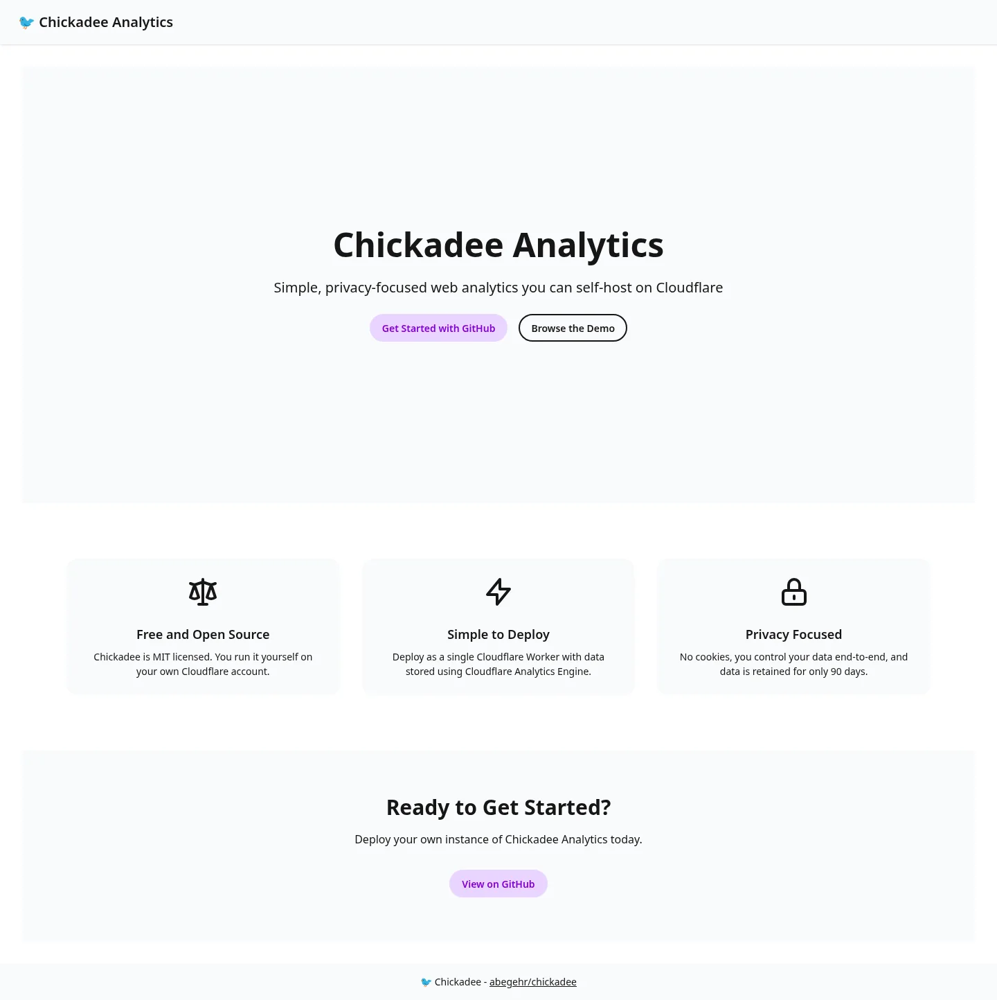
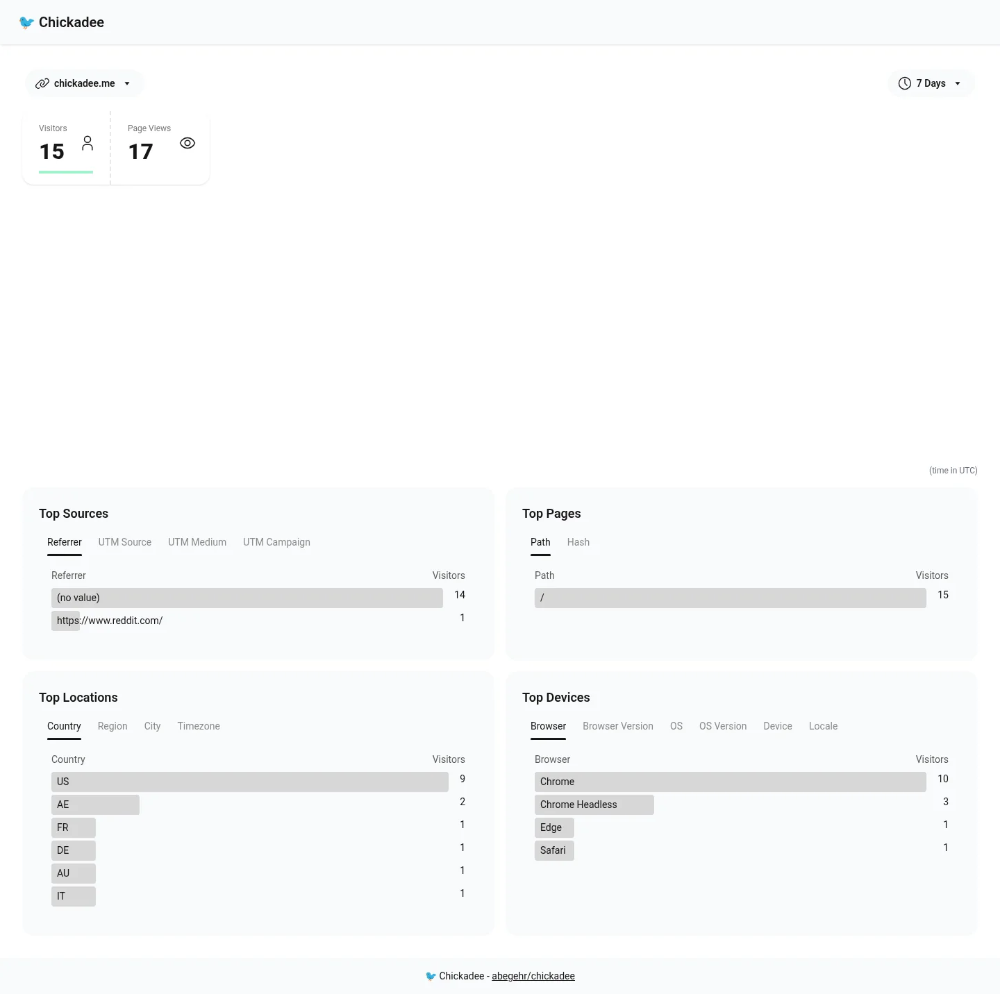
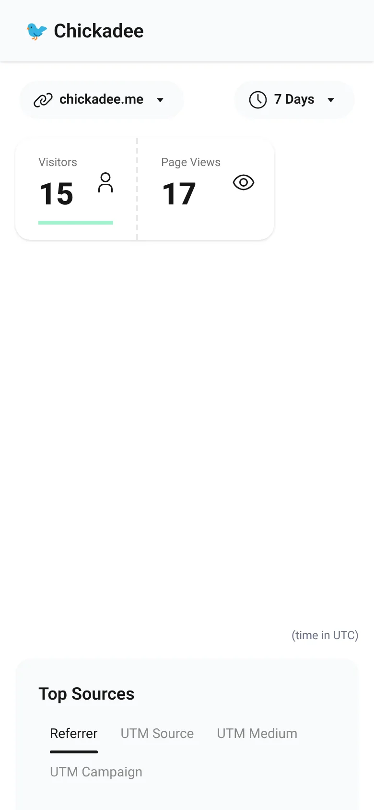

# Chickadee design guide

## Overview

Chickadee is a small, self-hosted analytics service you run on your own Cloudflare account. The look is stock daisyUI **pastel**: white and cool grey paper, near-black type, a lilac primary pill, and a mint accent used as a 4px underline on the selected metric. The mark is the bird emoji 🐦 plus the word "Chickadee" (or "Chickadee Analytics" on the marketing nav). Tone: quiet, utilitarian, close to Plausible / Counterscale. No custom typography and no custom colour overrides — `packages/web/app/style.css` and `packages/app/app/style.css` are the same two-plugin block (`themes: pastel --default, sunset --prefersdark`).

## Colors

Hex values converted from the live computed OKLCH (pastel, 1440).

- **Primary `{colors.primary}` (#E9D4FF):** lilac fill for `btn-primary`. Label is `{colors.on-primary}` (#8000D9). Contrast is about 5.3:1, which meets AA for the 14px / 600 button text.
- **Paper:** `{colors.base-100}` (#FFFFFF) page; `{colors.base-200}` (#F9FAFB) hero, nav, cards; `{colors.base-300}` (#E5E6E7) hairlines and bar-chart fills in the tables.
- **Ink `{colors.base-content}` (#161616).**
- **Accent `{colors.accent}` (#A3F2CE):** the 4px mint rule under the active Visitors / Page Views stat.
- **Also in the theme, little used on these screens:** secondary #FECCD2, info #51E8FB, success #7AF1A7, warning #FFB667, error #FF9FA0, neutral #61738D, neutral-content #DFE5ED.
- **Chart (hardcoded, not theme tokens):** visitors line `#10B981`, pageviews line `#1A56DB` (`packages/app/app/components/timeline.tsx`).

The CSS also enables daisyUI **sunset** when `prefers-color-scheme: dark`. This guide records the default pastel appearance of the live site in a light-preference browser; sunset values were not captured.

## Typography

System UI sans (`ui-sans-serif, system-ui, sans-serif` on the marketing site; the dashboard computed as `-apple-system, BlinkMacSystemFont, "Segoe UI", …` — the same idea, no webfont). Measured at 1440: hero `h1` 48px / 700 / 48px (`text-5xl font-bold`); lead 20px / 28px; feature and dashboard card titles 18px / 600; body 16px / 24px; buttons 14px / 600; "(time in UTC)" 12px.

## Layout

Marketing: a 64px `navbar` (`bg-base-200`, 8px padding) over a centred `hero min-h-[70vh] bg-base-200`, then a 3-column feature grid (`max-w-7xl`, 32px gap, 64px vertical padding) of `card bg-base-200` items with a 48px outline icon, a `card-title` and a short paragraph. A second `bg-base-200` band ("Ready to Get Started?") and a footer with the bird and `abegehr/chickadee`. At 390 the feature cards stack.

Dashboard: the same navbar, a site switcher pill and a "7 Days" pill, a compact `stats stats-horizontal shadow` pair (Visitors / Page Views), a 384px-tall (`h-96`) Chart.js timeline, then a 2×2 grid of `card bg-base-200` tables (Top Sources, Top Pages, Top Locations, Top Devices) with underlined tab-like column switches and grey value bars.

## Elevation & Depth

pastel sets `--depth: 0`, so primary buttons have no useful drop shadow. Cards are flat (base-200 on white). The stats cluster uses daisyUI `shadow`. Tables use grey bars, not shadows, for magnitude.

## Shapes

Stock cupcake-like radii on pastel: `--radius-box` and `--radius-selector` 1rem (16px) for cards and the stats cluster; `--radius-field` 2rem (32px) for buttons and the site / range pills. Borders are 2px. Icons are 48px stroke-2 Heroicons on the marketing cards; dashboard uses Iconify Carbon glyphs.

## Components

- **Primary button:** lilac fill, purple label, 32px radius, 40px high, 16px horizontal padding.
- **Outline button:** transparent with a 2px ink ring, same size and type.
- **Navbar wordmark:** emoji bird + 16px text, no custom logo file (`public/favicon.svg` is the same emoji).
- **Feature / dashboard card:** `card bg-base-200` + `card-body`, 16px radius.
- **Stats:** daisyUI `stats` with `stat-title`, `stat-value`, `stat-figure`; a `h-1 bg-accent` rule under the selected metric.
- **Dimension tables:** heading 18px / 600, a text tab row with a black underline on the active tab, rows with a grey (`base-300`-like) bar and a trailing count.
- **Timeline:** Chart.js line, 384px tall, visitors `#10B981` / pageviews `#1A56DB`. On the live demo captured on 2026-11-25 the canvas was present but the line did not paint, leaving a blank band between the stats and the tables.

## Do's and Don'ts

Do
- Keep pastel as the default and treat sunset as the dark companion — change both CSS files together.
- Use daisyUI semantic classes (`btn-primary`, `bg-base-200`, `stats`) so the marketing site and the dashboard stay aligned.
- Keep the mark as the bird emoji plus the word; do not invent a logotype.

Don't
- Don't introduce a webfont or a custom primary without updating both packages.
- Don't hardcode Tailwind greys or chart hexes in new UI; prefer theme tokens (see Open Issues).
- Don't add tracking cookies; the product is built around a daily-rotating fingerprint and a 90-day retention claim on the homepage.

## Illustration & Imagery

No photography, no custom illustration. The only identity asset is the 🐦 emoji (favicon and wordmark). Marketing icons are outline SVGs (scale, lightning, lock). Dashboard icons are Iconify Carbon (`carbon--user`, `carbon--view`, and the globe / clock in the pills).

## Asset Inventory

| Asset | Path |
|---|---|
| Favicon | `packages/web/public/favicon.svg`, `packages/app/public/favicon.svg` (🐦) |
| Tokens | `packages/web/app/style.css`, `packages/app/app/style.css` |
| Marketing | `packages/web/app/routes/index.tsx` |
| Dashboard widgets | `packages/app/app/components/stats.tsx`, `timeline.tsx`, `packages/app/app/islands/chart.tsx` |
| Screens for this guide | `docs/visual/*.webp` — live captures 2026-11-25 from www.chickadee.me and chickadee-demo.5sides.workers.dev |

## Open Issues

1. **Timeline does not paint on the live demo** in these captures: a 384px gap sits between the stats and the tables, even though a `<canvas>` is in the DOM. Likely a Chart.js time-scale / adapter problem. Fix the chart and re-capture.
2. **Chart colours are hardcoded** (`#10B981`, `#1A56DB`) and are not pastel tokens. So is `(time in UTC)` (`text-gray-500` instead of a theme muted colour).
3. **Two font stacks** are computed for the same system-sans idea (marketing `ui-sans-serif`, dashboard `-apple-system…`). Harmless, but they should share one stylesheet reference.
4. **Sunset (dark) is configured but undocumented here.** Capture sunset tokens and screens before calling the dark theme done.
5. **No logo** beyond the emoji; the favicon is a 100×100 SVG with a single 🐦 character. Fine for now, weak when a platform needs a monochrome mark.
6. **Secondary / info / warning / error** are unused on the captured screens.

## How to update

1. Edit the daisyUI theme block in both `style.css` files; mirror tokens in the front matter (convert OKLCH to hex).
2. Run `npx @google/design.md lint DESIGN.md`.
3. Refresh `docs/visual/` (WebP or optimised JPG, at most 1600px wide, ideally under 300KB each, no videos). Re-capture the dashboard once the timeline paints.
4. Add a dated Changelog line; move resolved items out of Open Issues.

## Changelog

- **2026-11-25:** Initial DESIGN.md from the pastel theme in both `style.css` files and computed styles / screenshots of www.chickadee.me and the public demo dashboard (1440 and 390). The timeline chart did not paint in the captures.
